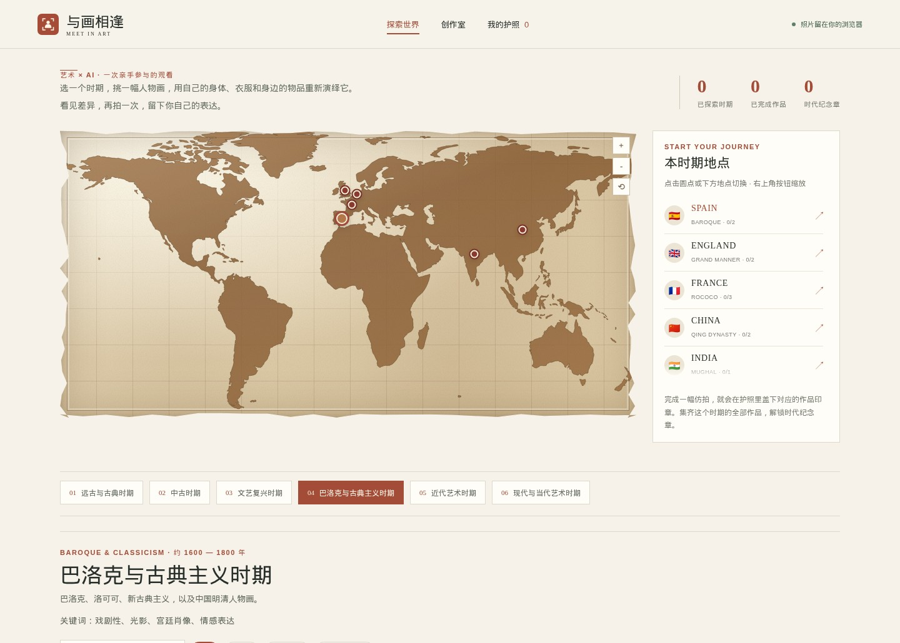
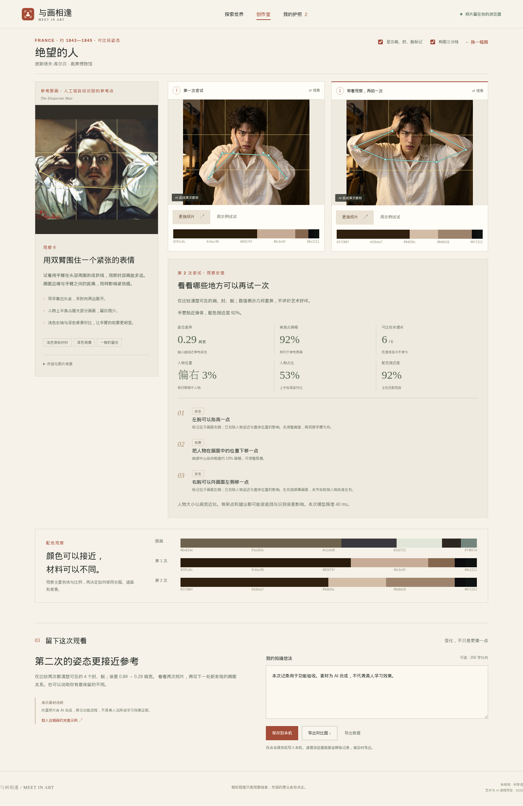
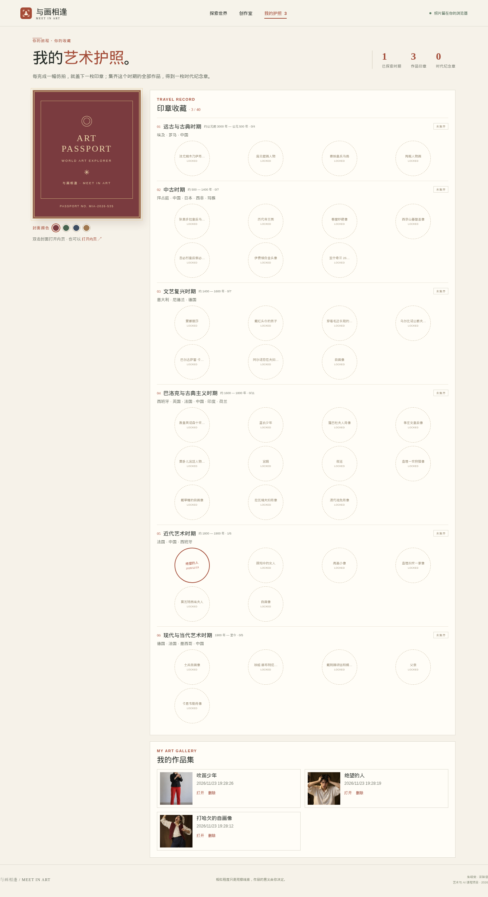

<div align="center">

# 与画相逢 · Meet in Art

**以身体回应经典，让自己成为画中人。**

探索人物画的时间与地域，在仿拍中观察，再将自己的作品收入艺术护照。

[最新版 PPT](deliverables/与画相逢-作业介绍.pptx) · [PDF 在线预览](deliverables/与画相逢-作业介绍.pdf) · [下载当前源码](https://github.com/happyeyeryday/meet-in-art/archive/refs/heads/main.zip) · [详细使用说明](docs/使用与开发说明.md)

</div>



<p align="center">6 个历史阶段 · 40 件探索作品 · 本地姿态分析 · 可拖拽排版的艺术护照</p>

## 这是一个什么项目？

《与画相逢》是艺术与 AI 课程的交互网页项目。你可以沿着世界地图与时间线浏览人物画，选择一幅作品，用自己的照片模仿姿态、构图与配色；看完反馈后再拍一次，把尝试和新发现保存在个人护照里。

| 探索世界 | 创作室 | 我的护照 |
| --- | --- | --- |
| 切换六个时期，浏览地点与画作，按名称和难度筛选 | 上传两次照片，查看骨架、构图、色板与调整建议 | 收藏作品印章，把照片、原画和贴纸拖进双页作品集 |

## 老师怎么体验？

**默认不需要 API、无需自备照片，也不用安装 npm 依赖。** 模型、图片和演示照片已经放在仓库中。

1. 电脑准备 **Node.js 22.19 或更高版本**，浏览器使用 Chrome / Edge。
2. 点击 **[下载当前源码 ZIP](https://github.com/happyeyeryday/meet-in-art/archive/refs/heads/main.zip)**，下载后完整解压。
3. Windows 打开解压目录里的 `app`，双击 **`start-demo.bat`**，保持启动窗口打开。
4. 浏览器打开 **[http://127.0.0.1:4173](http://127.0.0.1:4173)**。

macOS / Linux：在解压后的项目根目录执行 `bash app/start-demo.sh`，再打开同一个地址。首次启动自动构建；按 `Ctrl+C` 停止。

> GitHub 提供源码和课程材料，网页需要先在本地启动。目前没有公开在线试玩网址。请下载当前源码，旧的 **v1.0.3 Release** 不含地图与护照新版。

### 两分钟演示路线

**探索世界 → 页面下方“内置示例” →《绝望的人》→ 载入完整示例 → 保存到本机 → 我的护照 → 打开内页。**

进入创作室后，点击“载入这幅画的完整示例”，等待两次照片分析完成。看看肘腕位置、人物远近和配色的区别，写一句拍摄想法，再点击“保存到本机”。进入护照后，可打开内页，把自己的仿拍、原画和贴纸拖到书页上。

完整示例包括《打哈欠的自画像》《绝望的人》《吹笛少年》，共六张 **AI 合成照片**，用于展示功能，不是真人试用数据。

## 看看新版页面

下面均为当前地图／护照版本的实际运行截图。

<table>
<tr><th>创作室：对照原画，观察两次尝试</th><th>我的护照：作品、印章与个人收藏</th></tr>
<tr>
<td width="50%"></td>
<td width="50%"></td>
</tr>
</table>

护照内页支持拖放照片、原画、印章与贴纸，也可以加页、翻页和自动保存。创作室支持导出 PNG 对比图与 JSON 记录；目前不支持整本护照导出。

## 当前作业材料

| 文件 | 内容 |
| --- | --- |
| **[与画相逢-作业介绍.pptx](deliverables/与画相逢-作业介绍.pptx)** | 最新 17 页，包含选题、六时期整理、地图、创作室、护照、价值与不足 |
| **[与画相逢-作业介绍.pdf](deliverables/与画相逢-作业介绍.pdf)** | 同一份 PPT 经 Microsoft PowerPoint 导出的 17 页 PDF，可在线预览 |
| [课程材料目录](deliverables/README.md) | 当前材料与历史归档的位置 |

旧版 12 页 PPT、PDF 和讲稿已收进 [2026-11-02 历史归档](deliverables/archive/2026-11-02/)。原报告、原视频和旧 Release 保留作历史记录；这次提交使用上面的新 PPT/PDF 与本仓库链接。

## AI 做了什么？

- **本地姿态识别**：MediaPipe 检测人体关键点，结合参考点解释姿态和构图差异。
- **本地配色观察**：提取主要颜色，用色板帮助观察服装、背景与画面的关系。
- **可选在线点评**：配置自己的接口后可生成文字建议。启用时会把原画与仿拍发送到所配置的服务；不配置也能完成上述全部演示流程。

姿态误差和配色接近度只是观察线索，不是艺术成绩。照片分析目前针对单人；探索目录中的多人题材标签不代表支持多人比较。新增画作识别效果尚未逐幅验证，课堂演示建议先用三幅完整示例。

照片、作品与护照布局默认保存在当前浏览器。更换浏览器、端口或清理站点数据会影响记录，建议同时导出 PNG / JSON。

## 常见问题

**以前下载过，怎么还是旧界面？** 在项目根目录执行下面的命令，重启服务并刷新浏览器：

```bash
git pull --ff-only
node app/scripts/build.mjs
```

如果用的是 ZIP 下载，重新下载并完整解压最新版即可。

**提示找不到 node？** 安装 Node.js 22.19 或更高版本后，重新打开启动窗口。

**原画没有识别到参考点？** 可重试自动识别，或手动补标肩、肘、腕六个关节。自己的照片尽量只有一人，肩臂清晰。

**想配置在线 AI、查看指标解释或开发测试？** 阅读 [使用与开发说明](docs/使用与开发说明.md)。

## 运行验证与目录

当前通过 **22 项单元测试、类型与资源检查，以及 44 项真实浏览器检查**。另用全新源码副本验证了无 `node_modules`、无预构建文件、无 API 配置时的首次启动与完整演示。详见 [全新下载验收记录](evidence/presentation-2026-11-23/clean-checkout.json)。这些是功能检查，尚未开展真人学习效果研究。

| 目录 | 放什么 |
| --- | --- |
| `app/` | 网页源码、启动脚本、本地模型与图片 |
| `deliverables/` | 最新 PPT/PDF 和旧材料归档 |
| `docs/` | 展示图片、详细使用与开发说明 |
| `evidence/` | 运行截图与验收记录 |
| `tools/` | 文档导出、启动验证与打包工具 |

---

朱昭荣、宋琪语 · 艺术与 AI 课程项目 · 2026-11-23
