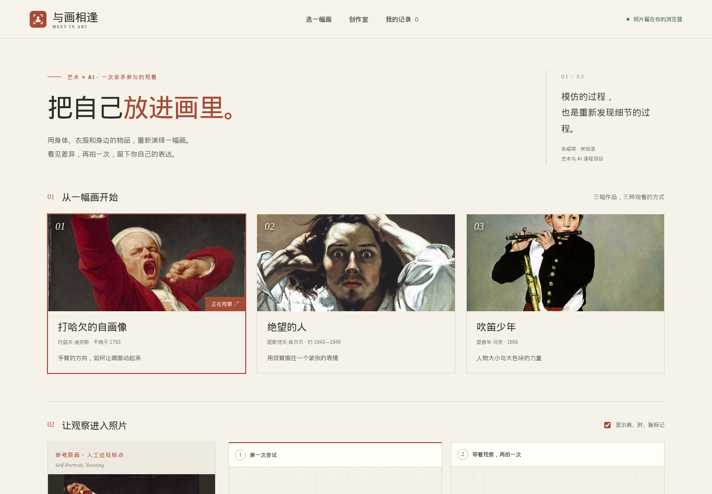

# 与画相逢 · Meet in Art

**以身体回应经典，让自己成为画中人。**

一个可以在电脑本地运行的中文网页：选择名画、上传仿拍照片，查看姿态、构图和配色反馈，再对比两次尝试。

**日常使用只需要启动网页，无需安装 npm 依赖，也无需重新下载模型。** 模型、原画、示例照片和字体已经放在项目中。



[下载离线演示包或完整结课包](https://github.com/happyeyeryday/meet-in-art/releases/latest) · [操作视频](deliverables/名画仿拍_真实演示.webm) · [项目报告](deliverables/项目报告_最终版.pdf) · [答辩 PPT](deliverables/答辩演示_最终版.pptx)

项目原题名为“把自己放进画里”，早期网页名为“入画”。课程报告、PPT、原选题文件和录屏保留原题名，它们与本仓库是同一个项目；当前网页及新导出的对比图使用“与画相逢”。

## 先选一种获取方式

| 你的用途 | 下载什么 |
| --- | --- |
| 只想体验网页 | Releases 中的 `入画_离线演示包.zip`，解压后启动 |
| 要源码、报告、PPT、视频等整套材料 | Releases 中的 `名画仿拍_完整结课包.zip` |
| 和队友一起修改 | 克隆本仓库，或点击 GitHub 的 **Code → Download ZIP** 后解压 |

安装了 Git 的同学可以执行：

```bash
git clone https://github.com/happyeyeryday/meet-in-art.git
cd meet-in-art
```

GitHub 提供源码与材料下载；网页运行在你自己的电脑上。

## 1. 启动网页

电脑需要 **Node.js 22.19 或更高版本**，浏览器使用 Chrome 或 Edge。已经安装过 Node.js 就不用重复安装，可以在终端输入 `node --version` 查看版本。

### Windows：双击启动

1. 打开项目中的 `app` 文件夹。
2. 双击 **`start-demo.bat`**。
3. 保持弹出的终端窗口打开，在浏览器中访问：

   **[http://127.0.0.1:4173](http://127.0.0.1:4173)**

启动脚本会显示地址，需要自己在浏览器中打开。从 GitHub 下载的源码会在第一次启动时自动生成网页，无需另外安装依赖。不要直接双击 `app/dist/index.html`。

### WSL / Linux / macOS：命令启动

在项目根目录（本 README 所在目录）打开终端，执行：

```bash
bash app/start-demo.sh
```

也可以使用通用命令：

```bash
node app/scripts/start-demo.mjs
```

然后打开 **http://127.0.0.1:4173**。服务启动后会一直占用这个终端，这是正常的；使用期间不要关闭它。

**停止网页服务：**在运行服务的终端中按 `Ctrl+C`。下次使用时重新启动即可。

## 2. 先用示例体验

不需要准备自己的照片：

1. 在首页选择一幅画，例如 **《绝望的人》**。
2. 向下滚动到创作区，查看原画和观察卡。
3. 在“第一次尝试”下点击 **“用示例试试”**，等待本地分析完成。
4. 在第二次尝试下也点击 **“用示例试试”**。
5. 查看两张照片的关键点、建议、色板，以及页面下方的两次变化说明。

也可以在页面靠下的“演示素材说明”中点击 **“载入这幅画的完整示例”**，一次载入两张照片。

内置三幅作品：《打哈欠的自画像》《绝望的人》《吹笛少年》。六张示例照片均为 **AI 合成演示素材**，不是真人试用数据。

## 3. 上传自己的照片

1. 选画后，参考观察卡摆姿势并拍一张照片。
2. 点击 **“上传照片”**，选择 JPG、PNG 或 WebP 文件。
3. 查看反馈，选择一两处想调整的地方，再拍一张并上传到第二个位置。
4. 在 **“我的拍摄想法”** 中写下发现或有意保留的不同，最多 200 字。

照片要求：每张不超过 **20 MB**，宽和高都至少 **100 像素**。尽量只有一位人物，让肩膀和手臂清楚入镜；HEIC 照片请先转换为 JPG。

可以点击照片上方的 **“镜像”** 翻转并重新分析，也可以关闭 **“显示肩、肘、腕标记”**，直接观察照片。

## 4. 怎么看结果

| 页面内容 | 含义 |
| --- | --- |
| 姿态差异 | 以肩宽为单位，越小表示参与比较的关节位置越接近参考；不是艺术评分。 |
| 肩宽占画幅 | 相对于原画的肩宽比例，帮助观察人物在画面中的大小。 |
| 调整建议 | 提示可以尝试改变的手臂位置或取景，最多三条，可以自行决定是否采用。 |
| 配色观察 | 展示原画与照片的主要颜色和比例。 |
| 两次变化 | 只比较两次都清楚可见的共同关节；信息不足时会明确提示。 |

参考原画上的点由人工近似标注，照片上的点由模型识别。遮挡、宽松衣服和拍摄角度都可能影响结果，可以结合画面自行判断。

## 5. 保存和导出

完成两次尝试后，可以使用：

- **保存到本机**：保存照片、分析结果和拍摄想法。下次打开网页，点击右上角 **“我的记录”**，即可打开或删除记录。
- **导出对比图**：下载一张 PNG，包含原画、两次照片、姿态变化和拍摄想法，适合展示或交作业。
- **导出数据**：下载包含照片和分析结果的 JSON，适合留档和技术复核。

照片在本机浏览器中处理。只有点击保存后才写入本地记录；换浏览器、换端口或清理浏览器数据后，原记录可能无法访问，请及时导出。

## 6. 演示视频和课程材料

- [真实网页操作视频（约 2 分 38 秒）](deliverables/名画仿拍_真实演示.webm)
- [最终项目报告](deliverables/项目报告_最终版.pdf)
- [12 页可编辑答辩 PPT](deliverables/答辩演示_最终版.pptx)
- [约 5 分钟答辩讲稿](deliverables/答辩讲稿_约5分钟.txt)

视频带有操作字幕，无配音，可以用 Chrome 或 Edge 打开观看。材料位于当前项目和完整结课包中；单独的离线演示包只包含网页运行文件。

## 7. 常见问题

**提示找不到 `node`，或“node 不是内部或外部命令”。**

需要先安装 Node.js 22.19 或更高版本，然后重新打开终端或启动脚本。

**浏览器打不开地址。**

确认启动窗口仍然打开，并且显示了 `http://127.0.0.1:4173`。这个地址用于运行服务的这台电脑，不能当作公开网站地址发给其他人。

**提示端口被占用（`EADDRINUSE`）。**

可能已经启动了一次，先尝试打开原地址。如果需要换端口，在项目根目录执行以下命令，随后访问 `http://127.0.0.1:4174`：

Windows CMD：

```bat
set PORT=4174
node app/scripts/start-demo.mjs
```

Windows PowerShell：

```powershell
$env:PORT = "4174"
node app/scripts/start-demo.mjs
```

WSL / Linux / macOS：

```bash
PORT=4174 node app/scripts/start-demo.mjs
```

**出现“AI 姿态识别暂不可用”。**

确认是通过本地地址打开，而不是直接打开 HTML 文件。然后在项目根目录检查资源：

```bash
node app/scripts/check-assets.mjs --dist
```

如果提示缺少文件，请重新完整解压演示包，保留 `app/dist` 内的模型、WASM 和素材，不要只复制 HTML 文件。

**没有识别到人，或者提示多人。**

换一张光线清楚、只有一位人物、肩膀和手臂完整入镜的照片。也可以先用内置示例确认功能正常。

<details>
<summary>开发补充：修改代码后怎么更新网页（只体验可跳过）</summary>

源码位于 `app/src`，本地服务读取的是 `app/dist`。修改源码后，在项目根目录重新构建，再刷新浏览器：

```bash
node app/scripts/build.mjs
```

运行不依赖 npm 安装的单元测试：

```bash
node --experimental-strip-types app/scripts/test.mjs
```

如需安装开发工具并执行类型检查：

```bash
cd app
npm ci --ignore-scripts
npm run typecheck
```

`npm ci` 需要联网；普通网页体验不需要执行这些开发命令。

仓库结构：`app` 是网页源码与离线资源，`deliverables` 是课程材料，`evidence` 是验收记录，`tools` 是生成文档与打包的工具。生成的 `app/dist`、npm 依赖、ZIP 和本机配置不会进入 Git。

与队友协作时先 `git pull`，修改后重新构建、检查，再提交源码。不要把模型换成占位文件，也不要删除素材来源和第三方许可。

主分支提交会自动运行构建、单元测试、类型及资源检查。维护者推送 `v*` 版本标签后，GitHub Actions 会重新打包并发布两个 ZIP 及 `SHA256SUMS.txt`；普通使用者不需要操作这些步骤。

</details>

---

朱昭荣、宋琪语 · 艺术与 AI 课程项目
