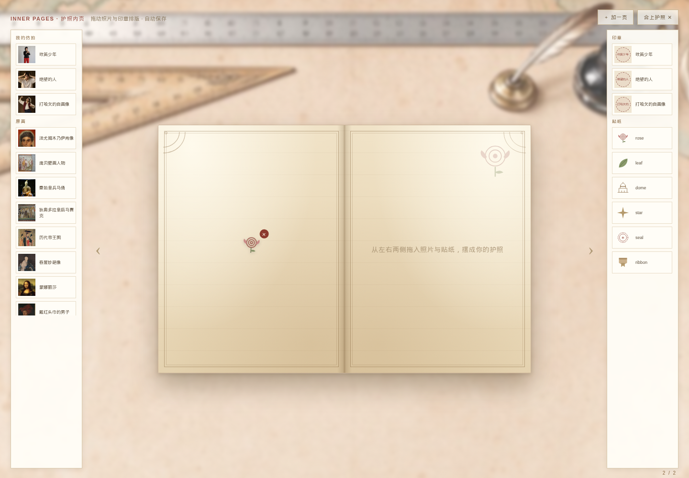

# 使用与开发说明

[返回项目首页](../README.md)

## 1. 怎么启动

准备 **Node.js 22.19 或更高版本**，浏览器使用 Chrome 或 Edge。模型、WASM、图片和字体随源码提供；基本功能不需要安装 npm 依赖或配置 API 令牌。

从 GitHub 下载：点击 **Code → Download ZIP** 后完整解压，或者：

```bash
git clone https://github.com/happyeyeryday/meet-in-art.git
cd meet-in-art
```

### 已经有旧版：拉取后先重新构建

```bash
git pull --ff-only
node app/scripts/build.mjs
```

**这一步很重要：** 启动脚本只在缺少 `app/dist/index.html` 时自动构建。旧电脑已经存在 `dist`，单纯拉取并重启仍可能显示旧页面。修改源码后也要重新构建。

### Windows

1. 打开项目里的 `app` 文件夹。
2. 双击 **`start-demo.bat`**，保持弹出的窗口打开。
3. 在浏览器访问 **[http://127.0.0.1:4173](http://127.0.0.1:4173)**。

### WSL / Linux / macOS

在项目根目录执行：

```bash
bash app/start-demo.sh
```

通用命令也可以：

```bash
node app/scripts/start-demo.mjs
```

打开同一个本地地址。按 `Ctrl+C` 停止服务。不要直接双击 HTML 文件。

## 2. 两分钟体验新版

1. 开场点击 **“按下快门，走进画框”**，或者点击“跳过”。
2. 在 **“探索世界”** 页面滚动到下方的 **“内置示例”**，选择《绝望的人》。
3. 进入 **“创作室”**，点击 **“载入这幅画的完整示例”**；也可分别点击两次“用示例试试”。
4. 等待分析，查看关节标记、构图三分线、调整建议和色板。可切换当前尝试、镜像照片或关闭辅助线。
5. 填写 **“我的拍摄想法”**，点击 **“保存到本机”**，也可导出 PNG 对比图或 JSON 数据。
6. 点击顶部 **“我的护照”**，查看保存的作品和印章，再点击 **“打开内页”**。
7. 将两侧的照片、原画、印章、贴纸拖到书页上；可以移动、移除、加页和翻页，排版自动保存在当前浏览器。

内置完整演示为《打哈欠的自画像》《绝望的人》《吹笛少年》，共六张 **AI 合成示例照片**，不是真人试用数据。



## 3. 探索世界和上传照片

探索库有 **40 件作品**，分布在 **6 个时期、24 个“地点 × 时期”节点**。另有 2 件独立演示作品，总计 42 件；《绝望的人》同时属于探索库和完整演示。地点节点并不等于 24 个不同国家。

| 时期 | 探索作品数 |
| --- | ---: |
| 远古与古典 | 4 |
| 中古 | 7 |
| 文艺复兴 | 7 |
| 巴洛克与古典主义 | 11 |
| 近代艺术 | 6 |
| 现代与当代艺术 | 5 |

- 点击时间线切换时期；地图圆点与右侧列表展示该时期的地点及完成情况，悬停圆点可预览相关作品。
- 下方作品区显示当前时期的作品，支持按作品名、艺术家搜索，以及 EASY / MEDIUM / CHALLENGE 筛选。
- 点击作品进入创作室，阅读观察卡、道具提示、作品与图片来源。
- 普通作品没有内置仿拍照片，需要自己上传两次尝试。支持 JPG、PNG、WebP；每张不超过 20 MB，宽高至少 100 像素；HEIC 需先转换。
- 照片姿态分析当前针对单个人物。画作中的“2 人／多人”标签是题材提示，不代表系统支持多人姿态比较；展示时建议选择单人作品。

原来的三幅演示作品带预设人工参考点。新增作品尝试用本地模型识别原画关键点，并在浏览器缓存；识别不到时可重试，或按提示依次标出人物自身的左肩、右肩、左肘、右肘、左腕、右腕。没有有效参考点时，不生成姿态差异结论。

## 4. 反馈怎么理解

| 页面内容 | 含义 |
| --- | --- |
| 姿态差异 | 用肩宽归一化后的关节位置差异，越小越接近参考，不能当作艺术成绩 |
| 肩宽占画幅 | 相对原画的肩宽比例，近似观察人物远近 |
| 人物位置／人物占比 | 从可见肩、肘、腕区域估计的位置和高度关系，不是精确的人体分割结果 |
| 配色接近度 | 主色间距离得到的启发式百分比，不是审美评分或模型置信度 |
| 两次变化 | 比较两次共同可见的关节，避免遮挡造成虚假改善 |
| 本地评语 | 根据几何与配色数据拼接的文字提示 |
| 在线 AI 点评 | 配置服务后，由图像模型根据原画、仿拍和测量数据生成文字 |

自动参考点、人工点位、遮挡和透视都可能影响判断。新增作品未逐幅验证姿态识别效果；真实推理完整回归以三幅内置演示为基准。

## 5. 可选：启用在线 AI 点评

**不配置也能使用地图、姿态分析、配色、保存和护照。**

需要在线点评时，将 `app/.env.example` 复制为 `app/.env`，填写自己的接口信息后重启服务。示例中提供了队友使用的校内接口配置：

```dotenv
AI_BASE_URL=https://chat.ecnu.edu.cn/open/api/v1
AI_MODEL=ecnu-plus
AI_API_KEY=你的令牌
```

这里的地址和模型名来自项目配置示例；需要自己的有效令牌及可用额度。本次复核没有用真实令牌验证该服务。服务端使用支持图片输入的 OpenAI 兼容 `/chat/completions` 接口，令牌不会发给网页。环境变量优先于 `.env`。

**启用后的当前行为：** 选中的尝试分析完成或打开已保存的尝试时，会自动请求点评；“重新生成”可再次请求。原画与仿拍会缩放为最长边不超过 900 像素的 JPEG，并连同测量信息经本地服务发送到你配置的外部模型。页面顶部会显示“AI 点评时照片会发送”。不希望发送照片时，删除或清空令牌配置并重启服务。

仅调试界面可以在 `.env` 中设置 `AI_MOCK=1`。这会返回明确标注“模拟点评”的固定文本，不是实际模型结果。关闭模拟需删掉该行或改为 `AI_MOCK=0` 后重启。

`.env` 属于本机配置，不应交给队友或提交作业；Git 和打包脚本均排除它。只分享不含令牌的 `.env.example`。

## 6. 保存、护照与导出

- **保存到本机**：两次尝试与拍摄想法存入当前浏览器的 IndexedDB；在“我的护照 → 我的作品集”打开或删除。
- **护照进度**：保存作品后显示作品印章，探索库对应时期全部完成时显示时代纪念章。演示作品也可保存在作品集中。
- **护照内页**：布局、页数和贴纸自动写入 localStorage；它引用已保存的照片，删除对应记录后照片会显示为缺失。
- **导出 PNG／JSON**：导出的是当前创作室的三图比较和记录；目前没有整本护照导出，也没有 JSON 导入入口。

照片与记录在默认模式下本地处理。在线点评启用时存在上一节说明的外部图片请求。更换浏览器、端口或清理站点数据，会影响本地记录；建议同时导出 PNG／JSON。原有 v1.0.3 仿拍记录使用相同数据库，仍可在新版护照作品集中打开。

## 7. 课程材料与当前交付状态

- **[当前作业介绍 PPT](../deliverables/与画相逢-作业介绍.pptx)** / **[对应 PDF](../deliverables/与画相逢-作业介绍.pdf)**：17 页，包含选题、六时期数据整理、探索地图、创作室、艺术护照、项目价值与不足。
- [课程材料目录](../deliverables/README.md)
- [本次提交前检查与待办](../提交前检查.md)

<details>
<summary>历史材料（旧版三幅画流程，非当前答辩材料）</summary>

- [2026-11-02 旧 PPT、PDF、讲稿和版式源文件](../deliverables/archive/2026-11-02/)
- [原版操作视频，约 2 分 38 秒](../deliverables/名画仿拍_真实演示.webm)
- [原版项目报告](../deliverables/项目报告_最终版.pdf)

原报告与视频保留题名“把自己放进画里／入画”，尚未覆盖新增页面和在线点评。旧材料中的 36 项浏览器检查是当时结果。

</details>

项目目录：`app` 为网页、`deliverables` 为课程材料、`evidence` 为测试记录、`tools` 为文档与打包工具、`pictures` 为队友补充的原始图片。实际网页读取 `app/public` 构建出的资源。

## 8. 常见问题与开发检查

**拉取后仍是旧界面：** 执行 `node app/scripts/build.mjs`，重启本地服务，再刷新浏览器。

**提示找不到 node：** 安装 Node.js 22.19 或更高版本，重新打开启动窗口。

**端口被占用：** 先查看是否已有网页服务；需要另开时，WSL 使用 `PORT=4174 node app/scripts/start-demo.mjs`，Windows CMD 先执行 `set PORT=4174`，再运行启动命令。然后访问 `http://127.0.0.1:4174`。

**姿态模型不可用：** 确认通过本地 HTTP 地址打开，并执行 `node app/scripts/check-assets.mjs --dist` 检查模型和运行资源。

**没有识别到人物：** 先用内置示例确认运行正常。自己的照片尽量只有一人，肩臂清晰；原画识别失败可手动标点。不要把没有结果写成“识别通过”。

开发检查（安装开发工具时需要联网）：

```bash
cd app
npm ci --ignore-scripts
npm run typecheck
npm test
npm run check:assets
```

浏览器验收需先启动本地服务、准备 Chrome / Playwright Chromium，再在 `app` 中执行 `npm run test:browser`。默认服务端口 4173，可通过 `DEMO_URL` 指定地址；结果可用 `EVIDENCE_DIR` 写入独立目录。验收脚本使用独立浏览器配置并阻断外网，**在线点评须关闭**。

本次本地复核：22 项单元测试、类型和资源检查、44 项浏览器检查通过；另检查开场、42 张作品图片及在线点评关闭／模拟流程。真实外部模型未调用，真人试用未开展。详见 `evidence/review-2026-11-23`。

---

朱昭荣、宋琪语 · 艺术与 AI 课程项目
